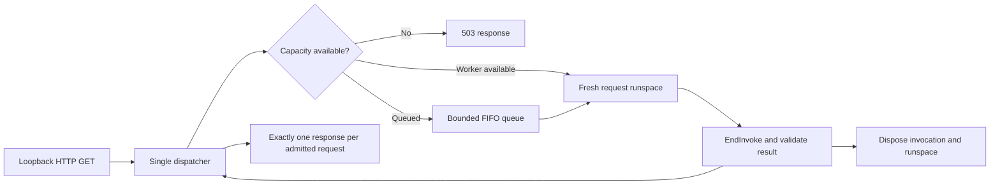

# PowerShell Request Engine

A small HTTP request scheduler built from `HttpListener`, asynchronous PowerShell invocation, and explicitly owned runspaces. It admits a bounded number of requests, returns `503` when capacity is full, and keeps each response attached to the request that created it.

The project grew out of an eight-worker PowerShell CRM/administration server. The [original scheduler excerpt](historical/crm-scheduler.ps1.txt) is preserved as inert source. This package is a focused modernization of its scheduling mechanism, with synthetic handlers and lifecycle tests. It does not include the original CRM, directory operations, or database integrations. [Provenance](PROVENANCE.md) separates the historical contribution from these changes.

## Run a local demonstration

Windows PowerShell 5.1 is the locally verified runtime. CI also checks PowerShell 7 on Windows. No third-party module, database, or service is required.

```powershell
./examples/Start-Demo.ps1
```

In a second terminal:

```powershell
Invoke-RestMethod http://127.0.0.1:8088/health
./examples/Invoke-Burst.ps1
```

The listener binds only to `127.0.0.1`. If Windows reports access denied when binding, choose a port allowed by your machine's HTTP URL policy; the package does not change URL reservations or request elevation. Press Enter in the first terminal to stop the demonstration.

## Use the engine

```powershell
Import-Module ./RequestEngine.psd1
$engine = Start-RequestEngine -Port 8088 -Workers 8 -QueueCapacity 16 -Handler {
    param($Request, $CancellationToken)
    @{
        StatusCode = 200
        ContentType = 'text/plain; charset=utf-8'
        Body = 'Request ' + $Request.Id + ' reached ' + $Request.Path
    }
}

Get-RequestEngineState $engine
Stop-RequestEngine $engine
```

Handlers receive a fresh record containing `Id`, `Method`, `Path`, and `Query`, plus a cancellation token. They return exactly one object with `StatusCode`, `ContentType`, and `Body`. No HTTP context, response stream, shared connection, caller variables, or captured closure is passed to the handler. The handler's source is compiled in its request runspace; define any helper it needs inside the handler.

`Get-RequestEngineState` returns detached counts and active/queued request identities. `Stop-RequestEngineRequest -Engine $engine -RequestId <guid>` requests cancellation of a particular active or queued request. Unknown/completed identities are harmless. Only the local controlling PowerShell session exposes these controls; there is no HTTP administration endpoint.

## Scheduling and ownership



The dispatcher alone admits requests, owns their HTTP contexts, sends responses, tracks deadlines, and reaps each invocation through its own `EndInvoke` handle. A cancelled request keeps its execution slot until its invocation actually ends and its runspace is disposed. New work cannot use that slot early.

The default limits are eight active workers, sixteen queued requests, a two-second admission-to-response deadline, a 2,048-character request target, and a 16 KiB response body. Queued requests can expire without ever creating a worker. Completed-handler results are also checked against the deadline before being returned. Response sends use `HttpListener`'s asynchronous close so a slow reader does not block the dispatcher; the response body is bounded before handing it to the transport.

Each request gets a **fresh runspace**, rather than borrowing the original server's `RunspacePool`. This removes PowerShell global-variable/function leakage between requests and avoids sharing a connection across workers. It costs runspace creation time on every request. There is no throughput or latency benchmark claim, and this is not a production web framework.

## Failure and cancellation behavior

| Condition | Response / behavior |
| --- | --- |
| Active workers and application queue are full | `503 capacity_exceeded`, `Retry-After: 1` |
| Deadline passes in queue or execution | `504 deadline_exceeded`; cancellation requested if running |
| Explicit request cancellation | `503 request_cancelled` |
| Shutdown | Queued and running requests receive `503 server_stopping`; no queued work starts |
| Handler throws, writes an error, or returns invalid output | Generic `500 handler_failed`; exception details stay off HTTP |
| Non-GET request or request body | `405`; this focused engine accepts bodyless GET only |
| Client disconnects | Its handler is reaped normally or by deadline; the execution slot is reclaimed |

Cancellation is **cooperative**. PowerShell cmdlets such as `Start-Sleep` can be stopped, but an arbitrary blocking native/.NET call may keep running until it returns. `Stop-RequestEngine -WaitMilliseconds 20` bounds the caller's wait; `Stopped = $false` means cleanup is still owned by the dispatcher. Keep the engine handle and call Stop again to finish disposal. A timeout does not kill a thread or prove that a handler's side effects were undone.

Fresh runspaces isolate PowerShell session state, not the operating-system process. Handlers are trusted code: environment variables, static .NET state, files, and external side effects are not sandboxed. Deadlines are observed by the dispatcher and cancellation may take longer than their nominal value. Application queue limits do not configure Windows HTTP.sys/socket buffering. Do not expose this demonstration as an authenticated, multi-user service.

## Validation

```powershell
./tests/Test-Provenance.ps1
./tests/Test-RequestEngine.ps1
```

The integration suite makes real loopback HTTP requests. It checks out-of-order completion and context correlation, saturation and zero-length queues, a concurrent burst, repeated global/function isolation, exceptions and invalid results, queued/running deadlines, explicit cancellation, a blocking native-call stop limit, client disconnect, shutdown idempotence, worker disposal, and listener-port release. It uses synthetic data and never executes the historical source or contacts an external service.

MIT license; copyright Derek Poe.
